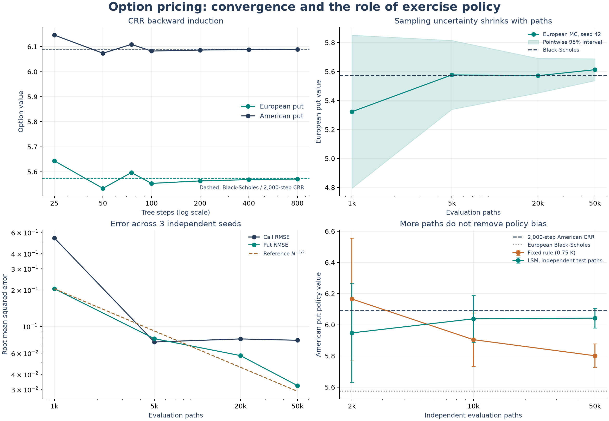

# Numerical Option Pricing in C++

**European and American vanilla options · CRR binomial trees · Monte Carlo · Variance reduction · Longstaff–Schwartz**

A reproducible numerical study of option valuation on a non-dividend-paying stock.
Six C++17 programs implement the pricing experiments; Python and a Jupyter
notebook turn their CSV output into convergence studies and visual explanations.
The project connects stochastic simulation, dynamic programming, regression,
and numerical verification in one compact research portfolio.

**Start here:** [How the files connect and how to run them](docs/quickstart.md).
This guide gives one Windows workflow, the role of each file, and examples of
running a single method.



## Research questions

- How do deterministic tree approximations and stochastic Monte Carlo estimates
  converge toward their respective references?
- How much do antithetic variates, control variates, and importance sampling
  reduce sampling variance after accounting for their simulation work?
- How does a learned exercise policy compare with a prescribed rule when
  valuing an American put?

The study uses constant-parameter risk-neutral geometric Brownian motion,
continuous compounding, and zero dividends. Both calls and puts are supported.
Black-Scholes is the European reference; a fine CRR tree is the American
numerical reference. The emphasis is numerical behavior and reproducibility.

## Six C++ source files

| File in `src/` | Purpose | Reference |
|---|---|---|
| [`binomial_european.cpp`](src/binomial_european.cpp) | European CRR tree, exercise at maturity | Black-Scholes |
| [`binomial_american.cpp`](src/binomial_american.cpp) | American CRR tree, exercise at every node | Fine CRR tree |
| [`monte_carlo_european.cpp`](src/monte_carlo_european.cpp) | Exact-terminal GBM simulation and uncertainty estimates | Black-Scholes |
| [`monte_carlo_american.cpp`](src/monte_carlo_american.cpp) | Simulation of a prescribed exercise policy | Fine CRR tree |
| [`variance_reduction.cpp`](src/variance_reduction.cpp) | Plain European MC, antithetic/control variates, and basic Newton importance sampling | Black-Scholes |
| [`lsm_american.cpp`](src/lsm_american.cpp) | Longstaff–Schwartz with independent train/test by default; optional paper-reproduction mode | Fine CRR / Bermudan CRR |

Shared headers in `include/` hold the contract model, CRR implementation,
stable statistics, and experiment interface. Each source file builds as a
separate executable; there is no seventh C++ driver or test source.

**American Monte Carlo requires an exercise policy.** The baseline uses a
transparent fixed boundary; its expected payoff is a lower bound on the optimal
American price. LSM learns continuation values through regression. Its default
mode trains and evaluates on independent paths; an explicit paper mode
reproduces the Longstaff–Schwartz Table 1 American-put setup. More paths alone
cannot remove policy bias. For a non-dividend-paying call with a nonnegative
interest rate, both American simulation programs use the optimal policy of
holding to maturity.

## Reproduce the study

Requirements: a C++17 compiler (GCC, Clang, or MSVC), Python 3.10+, and the
packages in [`requirements.txt`](requirements.txt) for plots and notebooks.
The C++ programs have no third-party library dependencies. Building and running
numerical tests requires only Python's standard library.

From the repository root, using a Python environment with the plotting packages:

```text
python -m pip install -r requirements.txt
python scripts/build.py
python tests/test_pricing.py -v
python scripts/run_experiments.py --quick
python scripts/plot_results.py
python scripts/verify_notebook.py
```

`build.py` finds `g++` or `clang++` on `PATH`; use `--compiler PATH` to select
one explicitly. It builds optimized executables in `build/` with C++17 and
compiler warnings enabled. `--debug` selects `-O0 -g`.

For an isolated Windows environment, create one before the commands above:

```powershell
python -m venv .venv-portfolio
.\.venv-portfolio\Scripts\Activate.ps1
python -m pip install -r requirements.txt
```

If using `uv`, an alternative is `uv venv --python 3.12 .venv-portfolio`, then
`uv pip install --python .venv-portfolio/Scripts/python.exe -r requirements.txt`.
On macOS/Linux, activate with `source .venv-portfolio/bin/activate`.

The quick profile uses seeds 42–44 and smaller path budgets. Omit `--quick`
for eight seeds and European budgets up to 500,000 paths. The scripts produce
seven CSV datasets and a manifest under `data/experiments/`, plus PNG and SVG
figures under `figures/`. A build manifest records compiler details and source
hashes. The checked-in example results use the quick profile. The illustrated
American baseline deliberately uses a suboptimal `0.75 K` boundary to make
policy bias visible; the executable's configurable default remains `0.85 K`.

To reproduce the paper's 20-case American-put parameter grid, then create
report figures for its LSM estimates and sample-size convergence, run:

```text
python scripts/run_lsm_paper.py
python scripts/plot_lsm_paper.py
```

This uses `K=40`, `r=0.06`, `S0` in 36–44, volatility 0.20 or 0.40, maturities
1 or 2 years, and 50 exercise dates per year. Each Table 1 case uses 100,000
paths arranged as 50,000 antithetic pairs and the paper's constant plus
weighted `L0`, `L1`, and `L2` Laguerre regressors. The paper-mode result is
in-sample; it is separate from the independent train/test LSM default and is
not the plain-Monte-Carlo baseline for the planned AV/CV/IS comparisons.
`--quick` runs a smaller smoke profile. Results and figures are written to
`data/experiments/` and `figures/`; the generated reference is a 2,000-step
Bermudan CRR tree aligned with the exercise dates, not the paper's
finite-difference reference.

### CMake alternative, including MSVC

```text
cmake -S . -B build/cmake -DCMAKE_BUILD_TYPE=Release
cmake --build build/cmake --config Release
ctest --test-dir build/cmake -C Release --output-on-failure
```

For experiment collection, pass `--build-dir build/cmake` on single-configuration
generators, or `--build-dir build/cmake/Release` for Visual Studio. CMake's tests
automatically select the correct executable directory. GitHub Actions is
configured to run numerical validation on Linux and Windows and check the
visualization workflow on Linux.

## Run individual methods

Each executable accepts `--help`. Programs print machine-readable CSV to
standard output, or write it to `--output PATH` and create parent directories.
Example commands for Windows PowerShell:

```powershell
.\build\binomial_european.exe --type call --steps 500
.\build\binomial_american.exe --type put --steps 800 --reference-steps 2000
.\build\monte_carlo_european.exe --type put --paths 100000 --seed 42
.\build\monte_carlo_american.exe --type put --steps 50 --paths 100000 --boundary-ratio 0.85
.\build\variance_reduction.exe --type call --paths 100000 --train-paths 5000
.\build\lsm_american.exe --type put --steps 50 --train-paths 50000 --paths 100000 --output data/custom/lsm.csv
```

On macOS/Linux use `./build/<name>` without `.exe`.

| Shared parameter | Default | Interpretation |
|---|---:|---|
| `--spot`, `--strike` | 100, 100 | Current stock price and strike |
| `--rate` | 0.05 | Annual continuously compounded risk-free rate |
| `--volatility` | 0.20 | Annualized volatility |
| `--maturity` | 1 | Years to expiry |
| `--type` | put | `call` or `put` |
| `--steps` | 50 | Tree intervals or American exercise intervals |
| `--paths` | 100000 | Main/evaluation sample path count |
| `--train-paths` | 50000 | LSM training paths or each independent control/importance-sampling pilot |
| `--reference-steps` | 2000 | CRR resolution for American reference prices |
| `--boundary-ratio` | 0.85 | Prescribed American MC boundary as a multiple of strike |
| `--seed` | 42 | Master seed for deterministic random streams |

European simulations use exact terminal sampling, so `--steps` does not change
their calculation. Tree programs ignore simulation controls. `--train-paths`
applies to LSM and both pilot-fitted variance reduction methods. `--reference-steps` applies
only to American references, and `--boundary-ratio` only to the prescribed-rule
American simulation. Variance reduction requires an even `--paths` count.
Zero maturity, zero volatility, and negative rates are handled explicitly.

Importance sampling uses the original basic Newton procedure directly on
the pilot second moment. Start from the exercise threshold, apply corrections
limited to `[-1, 1]`, and stop when the absolute gradient or shift change is
below `1e-8` (at most 50 updates). Plug the approximate shift back into the
likelihood-weighted pricing estimator. `--train-paths` sets the pilot size separately for the control and
importance-sampling methods; both include their pilot work and fitting time.
The fitted shift is an approximation based on a finite pilot and the
chosen stopping rules. An all-zero
pilot fails explicitly with a request for more pilot paths.

To inspect one fit, append `--newton-trace data/custom/newton.csv` to a
`variance_reduction` command. Its result row records the fitted shift,
iteration count, final gradient, initial/final second moment, and status.
The experiment runner saves all benchmark traces in `newton_convergence.csv`
and largest-budget median comparisons in `variance_summary.csv`.

### Current benchmark results

For `S0 = K = 100`, `r = 0.05`, `sigma = 0.20`, and `T = 1`, the quick
profile gives the following median estimator-variance reductions relative to
plain MC across seeds 42–44:

| Technique | European call | European put |
|---|---:|---:|
| Antithetic variates | 50.4% | 41.3% |
| Control variate | 85.4% | 58.0% |
| basic Newton importance sampling | **89.5%** | **86.6%** |

Each method uses 50,000 main-sample terminal payoff evaluations. The control
and IS methods each use a further 2,000-path independent pilot. These are
variance reductions, not runtime reductions. The corresponding median
pilot-adjusted work factors are 6.60x (control) and 9.12x (IS) for the call,
using payoff counts as a work proxy. The basic Newton fits converged in 5–6 updates.
These are contract-specific demonstration results from three seeds; they do
not imply a universal method ranking. See the full-precision
[summary](data/experiments/variance_summary.csv) and
[Newton traces](data/experiments/newton_convergence.csv).

An updated, concise [LaTeX thesis entry](docs/cv_thesis.tex) uses these measured
call-benchmark results and the independently evaluated LSM comparison.

## Notebook and visual explanations

Open [`notebooks/option_pricing.ipynb`](notebooks/option_pricing.ipynb) with
JupyterLab or VS Code. It includes an illustrated CRR tree, result tables,
convergence diagnostics, an exercise-grid study, and an editable cell that
calls the C++ executables for a new contract. Its saved outputs support
read-only review; rerunning the C++ exploration cell requires a local build.

| Figure | What it explains |
|---|---|
| [Convergence](figures/convergence.png) | Tree refinement, pointwise MC intervals, repeated-seed RMSE, and exercise-policy bias |
| [Variance reduction](figures/variance_reduction.png) | Standard errors and variance factors for all three techniques, including pilot work |
| [Newton convergence](figures/newton_convergence.png) | Fitted shifts, pilot second-moment reduction, and gradient convergence |
| [LSM exercise grid](figures/lsm_exercise_grid.png) | Sensitivity to exercise-date resolution and variability across training/evaluation seeds |
| [CRR teaching diagram](figures/binomial_tree.png) | Recombination, terminal payoffs, and the backward-induction decision |
| [Paper LSM convergence](figures/lsm_paper_convergence.png) | Value and RMSE paths as the antithetic sample grows |
| [Paper LSM parameter grid](figures/lsm_paper_table.png) | Paper-mode LSM estimates across all 20 contract cases |

## Validation and interpretation

The 29-test numerical suite checks known Black-Scholes prices, put-call parity at
multiple maturities, tree convergence, American put bounds, non-dividend call
exercise behavior, scale homogeneity, Monte Carlo accuracy, variance accounting,
importance-sampling likelihood weights, Newton convergence and independently
integrated population objectives, independent-policy LSM behavior,
deterministic edge cases, reproducibility, and invalid inputs.

For the default contract, the analytical European call and put prices are
**10.450584** and **5.573526**. These provide transparent reference values
before considering early exercise.

Monte Carlo intervals describe sampling uncertainty, with important limits:
LSM intervals condition on the fitted policy, and American policy comparisons
also contain exercise-grid and policy error. A fine CRR value is a numerical
reference, not a closed-form American price. Tree CI fields are degenerate
placeholders in the shared CSV schema, not tree error bounds. Seeds reproduce
samples within the same compiler and standard-library implementation; they
do not promise identical normal draws across platforms. The quick profile's
three seeds illustrate behavior and do not support precise coverage claims.

See [`docs/methodology.md`](docs/methodology.md) for equations, regression
details, CSV accounting, assumptions, and primary references.

## Repository map

```text
src/                       Six C++ experiment entry points
include/                   Shared pricing, statistics, and CSV interface
scripts/                   Build, collect experiments, plot, execute notebook
notebooks/                 Executed research walkthrough
tests/                     Numerical and input-validation tests
data/experiments/          Curated C++ results and reproducibility manifest
figures/                   PNG previews and SVG versions for presentation
docs/methodology.md        Mathematical and experimental specification
CMakeLists.txt             Portable C++ build and CTest integration
.github/workflows/         Automated validation configuration
```

## Further research

Planned extensions include broader contract parameter sweeps, LSM basis and
training-size studies, matched-date Bermudan references, and dual upper-bound
methods. These are future directions rather than implemented results.

The methods follow Cox, Ross and Rubinstein (1979), Longstaff and Schwartz
(2001), and standard Monte Carlo variance reduction. Bibliographic links are
provided in the [methodology references](docs/methodology.md#references).
